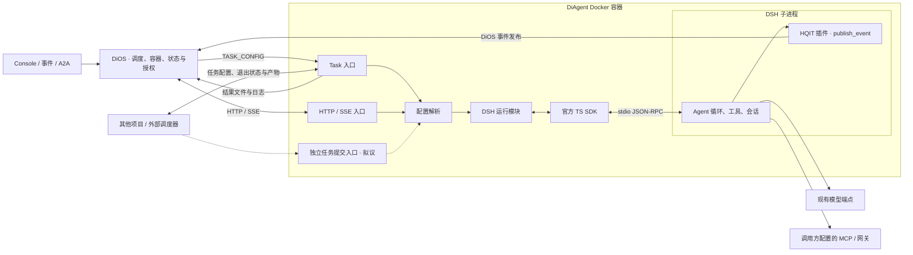
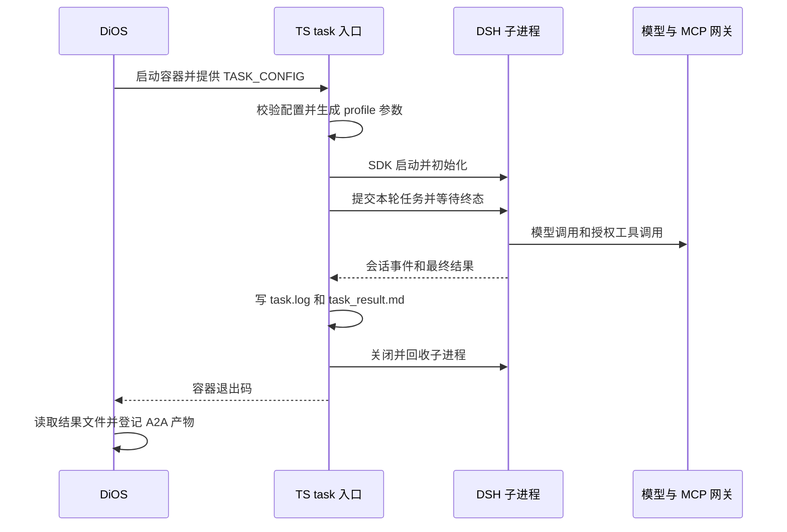
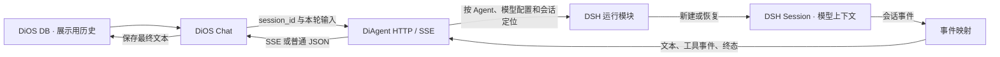
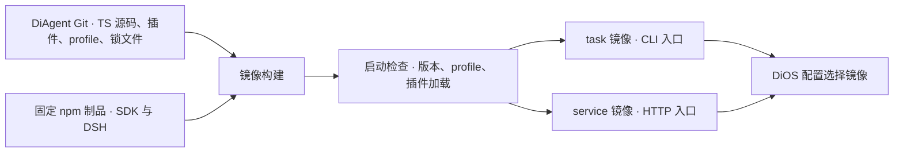

# TypeScript DiAgent 架构设计

2026-11-12。设计基于 DiOS `f2433d9`、独立 DiAgent `12190ee`、DiOS 内嵌 DiAgent `5e22fb3`。首个 Docker PoC 建议以 npm 版本页均列出的 `0.2.2-rc.1` 为候选基线。 [DSH npm 版本](https://www.npmjs.com/package/%40deepseek-ai/dsh?activeTab=versions) · [SDK npm 版本](https://www.npmjs.com/package/%40deepseek-ai/dsh-sdk-client?activeTab=versions)

首个目标是让一条现有 DiOS task 通过更换镜像切到 TypeScript DiAgent。第二个目标是接通常驻 Chat service。DiAgent 同时面向其他项目和外部调度器，任务执行、状态和产物契约可独立使用。

## 1. 选型与交付

**新 DiAgent 使用 TypeScript，依赖固定版本的官方 SDK 与 DSH 运行时，沿用 DiOS 现有 Docker 部署。** DiOS 启动容器、调度任务、发 HTTP 请求、接收状态与产物。DiAgent 在容器内通过 SDK 启动 DSH 子进程、提交任务、接收事件并负责收尾。SDK 的通信对端是 DSH，DiOS 仍通过现有 task 文件与 HTTP 契约调用 DiAgent。 [DSH TS SDK](https://github.com/deepseek-ai/deepseek-harness/blob/dsh-v0.2.2-rc.1/packages/sdk/client/README.md) · [DiOS Docker task](https://github.com/HQIT/DiOS/blob/f2433d950925b773ae33e7c50cb0579dea1d4115/backend/app/services/docker_runner.py#L32) · [DiOS Chat](https://github.com/HQIT/DiOS/blob/f2433d950925b773ae33e7c50cb0579dea1d4115/backend/app/api/apps/chat.py#L139)

**Git 里提交 DiAgent 源码、HQIT 插件、profile、Dockerfile 和依赖锁；镜像里安装可运行的 DSH。** 首选精确版本的 `@deepseek-ai/dsh` 和 `@deepseek-ai/dsh-sdk-client`。SDK 默认解析同版本的 DSH 可执行文件，也可以通过 `dshBin` 指向随镜像安装的版本。若 npm 制品无法在目标 Linux 镜像运行，可在镜像构建阶段检出固定的上游提交，构建运行产物并显式指定路径。引入长期维护的上游源码分支需要有具体的上游缺口作为依据。 [SDK 运行时解析](https://github.com/deepseek-ai/deepseek-harness/blob/dsh-v0.2.2-rc.1/packages/sdk/client/README.md#known-limitations-and-deferred-work)

**外部调度器可以直接使用一次性任务入口，传入 `TASK_CONFIG`，再读取退出状态和结果文件。** 后续增加独立的任务提交入口，复用同一套执行逻辑，对外提供运行标识、状态和结果。HTTP 是候选方式，接口字段在对应任务中定稿。DiOS 的事件路由和鉴权属于 DiOS 集成。独立运行的验收场景使用外部调用方自配的模型、工具和工作区，在无 DiOS 的环境中完成一次任务。

### 图 1 · 运行架构

## 2. 模块拆分

第一版在 DiAgent 仓库中维护 Cordis 插件，随镜像和锁定的 DSH 版本一起交付。Task 与 service 可共用插件和 DSH 启动逻辑，各入口按自己的工具选择规则装配。镜像保留各自的入口，方便沿用 DiOS 的两种容器启动方式。

| 模块 | 负责的行为与接口 | 代码位置建议 |
| --- | --- | --- |
| Task 入口 | 读 `TASK_CONFIG`，校验 once 配置，调用运行模块，原子写结果和日志，把成功、失败和中断映射为进程退出状态。 | `src/task/` |
| HTTP 入口 | 提供 `/health`、`/v1/chat/completions`，解析现有字段，映射普通 JSON、SSE、工具事件和错误。负责 HTTP 生命周期。 | `src/service/` |
| 配置 | 解析现有模型配置、角色提示、workspace、Skills、MCP、工具白名单与预算，生成本次启动所需的 DSH 配置。只把明确兼容的字段映射过去。 | `src/config/` |
| DSH 运行模块 | 对 task 提供一次运行及最终结果，对 service 提供会话句柄和运行事件。内部管理 SDK 初始化、通知订阅、根/子会话归属、等待终态、截止时间及子进程清理。 | `src/dsh/` |
| HQIT 插件 | 在 DSH 进程注册 `publish_event`，保留原有工具名与参数，按事件目录和来源规则检查后提交，返回 DiOS 处理结果。Task profile 默认加载插件，部署可关闭。 | `src/dsh/plugins/` |
| 运行配置与打包 | 固定 SDK、DSH、Node、插件及依赖。维护一套基础 profile 和 task/service 的必要差异，验证最终生效的插件列表。 | `profiles/`、`docker/`、`pnpm-lock.yaml` |

DSH 运行模块统一处理 SDK 细节。Task 和 HTTP 调用者拿到的是运行结果和必要事件；现有 Python 版作为独立镜像保留，用于对照和回滚。等第二个真实内核需要接入时，再决定是否抽象出通用运行时接口。

角色提示与工具权限在启动配置里落实。现有 `tool_selection` 对工具可见性的影响须通过真实工具列表验收。DSH 的 SDK profile 默认有自己的 coding persona 和工具集合，需用 HQIT profile 覆盖角色并收敛工具。按选定版本验证 MCP transport、鉴权头、Skills 路径及可见工具。DiOS 集成沿用其 MCP 网关，独立部署使用调用方配置的 MCP。 [DSH SDK profile 配置](https://github.com/deepseek-ai/deepseek-harness/blob/dsh-v0.2.2-rc.2/packages/bundle/sdk-app/cordis.patch.yml) · [DiOS MCP 网关](https://github.com/HQIT/DiOS/blob/f2433d950925b773ae33e7c50cb0579dea1d4115/backend/app/services/e2ag_tool_gateway.py#L118)

## 3. Task 首先实现换镜像

### 图 2 · 一次性任务时序

- **兼容输入与产出。** 用真实 DiOS 生成的配置做样本，覆盖顶层 `models`、`task.model`、`system_prompt`、`skill_names`、`mcp_config_path`、`workspace` 和 `output_dir`。输出遵循配置，DiOS 管理场景应能在 `/workspace/output/events/{run_id}` 收到 `task_result.md`。旧 standalone 的 cron、interval、检查点及子 Agent 配置按实际使用清单验收后再切换。 [配置生成](https://github.com/HQIT/DiOS/blob/f2433d950925b773ae33e7c50cb0579dea1d4115/backend/app/services/a2a_service.py#L446) · [产物读取](https://github.com/HQIT/DiOS/blob/f2433d950925b773ae33e7c50cb0579dea1d4115/backend/app/services/a2a_service.py#L360)
- **确认完成语义。** SDK 的入队回执、会话空闲和任务完成是不同信号。任务有子 Agent 时，验证低层 `session/wait` 的子任务等待语义。结合已记录的终止原因、产物写入和进程退出码判定成功，避免超时、模型失败或子任务未收尾被登记为完成。 [SDK 客户端](https://github.com/deepseek-ai/deepseek-harness/blob/dsh-v0.2.2-rc.1/packages/sdk/client/README.md#lower-level-control-with-harnessclient)
- **分开验证容器停止和 A2A 取消。** TS 入口收到停止信号后应关闭 DSH 并回收进程。当前 DiOS 的 A2A 取消只更新状态并撤销授权。若验收包含点击取消即停止容器，需要在 DiOS 将取消接到对应容器句柄，并处理完成与取消的竞争。 [现有 A2A 取消](https://github.com/HQIT/DiOS/blob/f2433d950925b773ae33e7c50cb0579dea1d4115/backend/app/services/a2a_service.py#L554)

## 4. Chat 的两个设计决策

### 图 3 · 建议的会话与事件流

**历史。** 当前 DiOS Chat 从数据库重建整段 `messages`，内部转发没有 `session_id`。候选 DSH SDK 的 `session/prompt` 只提交本轮用户内容，公开接口未提供导入整段 OpenAI 角色消息的能力。建议服务阶段做一处 DiOS 兼容扩展：继续发送原有消息结构，同时透传稳定的 `session_id`。新 DiAgent 按 Agent 和会话定位持久 DSH Session，每轮只提交新增用户输入。DiOS DB 继续用于展示和审计。历史会话先保留旧路径，迁移前验证用上下文引入历史、或从新会话开始的产品语义。直接调用 DiAgent 且只发完整历史的旧调用者，也需要单独的兼容测试。 [DiOS 历史与请求](https://github.com/HQIT/DiOS/blob/f2433d950925b773ae33e7c50cb0579dea1d4115/backend/app/api/apps/chat.py#L89) · [SDK 协议字段](https://github.com/deepseek-ai/deepseek-harness/blob/dsh-v0.2.2-rc.1/packages/sdk/protocol/src/types.ts)

**SSE。** 用实测确认 SDK 能提供的文本事件粒度。DiOS 目前收集 `choices[0].delta.content`，并从自定义 `tool_call` 的结束事件提取人工审批提示。第一轮测试要检查纯文本、工具调用、错误、中断和 `[DONE]`。若现有 SDK 通知只能满足已提交消息级的输出，而现有使用方要求实时文本增量，再验证 DSH 插件监听运行内事件并桥接到 DiAgent 的方案。该插件是否有稳定的事件来源，当前仍是 PoC 问题。 [DiOS SSE 消费](https://github.com/HQIT/DiOS/blob/f2433d950925b773ae33e7c50cb0579dea1d4115/backend/app/api/apps/chat.py#L158) · [SDK 通知接口](https://github.com/deepseek-ai/deepseek-harness/blob/dsh-v0.2.2-rc.1/packages/sdk/protocol/README.md#the-sdk-methods)

**进程粒度。** 首版 task 每容器一个 DSH 子进程。service PoC 可先每会话独立子进程，串行处理同一会话的 turn，并测启动延迟、空闲回收和会话恢复。候选 SDK 在进程初始化时绑定模型路由，且无单会话取消 RPC。共享进程应以相同配置和取消行为通过测试为前提。 [SDK 初始化与关闭](https://github.com/deepseek-ai/deepseek-harness/blob/dsh-v0.2.2-rc.1/packages/sdk/client/README.md)

## 5. 参考 EduWork 的装配方式

EduWork 构建时从锁定的 npm 制品准备 DSH Runtime 和独立插件包，同时从固定提交构建桌面 Host 和 Electron。对 DiAgent 最有用的是固定上游版本、独立维护插件和构建时装配。新 DiAgent 的 Host 就是面向 DiOS 的 TypeScript task/HTTP 入口。 [EduWork 构建指南](https://github.com/ECNU/EduWork/blob/main/docs/BUILD.md#候选构建做什么)

### 图 4 · 源码与镜像装配

构建时校验版本一致性，在实际锁定版本上复核 profile 及插件字段，执行 profile 检查，确认目标 Linux 容器内的原生依赖、工作区写权限和 DSH 沙箱可用。profile 显式控制默认遥测、Web 工具、模型路由和 MCP。业务 token 由部署注入，插件配置使用引用。运行制品与依赖记录可对应到镜像 digest。 [DSH 插件包规范](https://github.com/deepseek-ai/deepseek-harness/blob/dsh-v0.2.2-rc.2/docs/user/develop/basic/publish.md) · [DSH 默认行为](https://github.com/deepseek-ai/deepseek-harness/blob/dsh-v0.2.2-rc.2/apps/cli/reference/README.md#L119-L133)

## 6. 可行性与实施门槛

| 项目 | 判断 | 首次验收 |
| --- | --- | --- |
| 固定版本随镜像交付 | 路径清楚，待验证目标平台包与 Docker 内启动。 | 同一镜像启动两次，报告相同 DSH/SDK 版本，加载预期 profile，运行一条工作区命令。 |
| task 替换 | 首选切入点。外部契约集中，主要工作在配置和终态映射。 | 同一条 DiOS A2A task 用两个镜像对照。验证角色提示、实际模型、一个 Skill、只读 MCP、文件及报告路径。覆盖模型失败和容器停止。 |
| HQIT 插件 | 有明确的 DSH 插件加载机制，需验证工具授权及参数兼容。 | `publish_event` 只在获准配置中可见。用测试事件验证成功和拒绝，两种结果都能正确返回给 Agent。 |
| Chat 替换 | 主要不确定项。会话历史、流式粒度、取消和进程成本决定适配量。 | 从实际 DiOS 请求跑两轮 Chat、两个并发会话和一个工具调用。核对历史无重复、SSE 与前端行为、状态和断开处理。 |
| 全量替换 | 取决于现有调用清单。 | 查明 `/v1/events`、`/v1/tools`、`/v1/sessions`、独立触发器、子 Agent 配置、检查点的使用情况并确定迁移验收。用新旧镜像配置做一次回滚演练。 |

实施顺序建议是 **镜像与 profile 冒烟 → 一个真实 task 换镜像 → Chat 契约 PoC → 按 Agent 或部署灰度**。Task 与 service 的镜像版本可独立切换。当前 DiOS 的镜像选择主要来自实例级配置。若需要同一实例内按 Agent 选择新旧镜像，应增加对应配置并验证回滚，或使用独立验证环境先切一条任务。 [DiOS 镜像配置](https://github.com/HQIT/DiOS/blob/f2433d950925b773ae33e7c50cb0579dea1d4115/backend/app/config.py#L13)

本设计基于本地源码和上游公开接口，未在目标 Linux 镜像中运行 DSH。图中的会话 ID 透传、插件权限和运行事件映射均为拟议设计。当前交付为架构文档，未修改产品代码。
