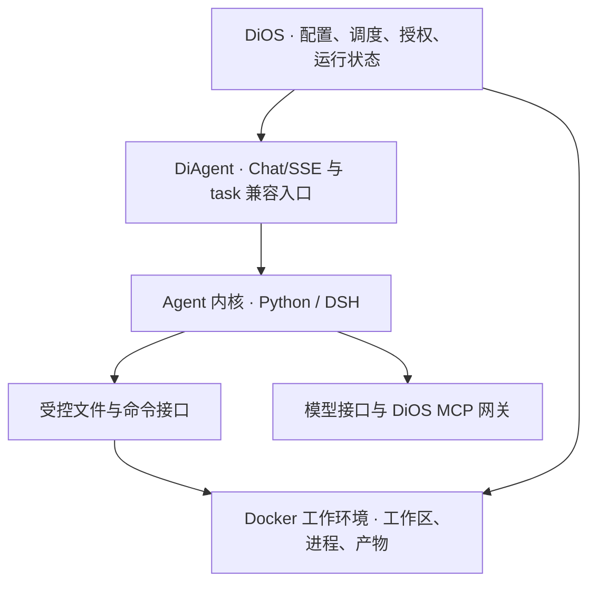

# DiAgent 参考或采用 DeepSeek Harness 的重构可行性分析

调研日期 2026-11-12。本文将 dsh 理解为 DeepSeek 官方的 [DeepSeek Harness](https://github.com/deepseek-ai/deepseek-harness)。评估面向 DiOS 当前的单机部署与已有 Agent 工作负载，覆盖交互对话、事件触发的一次性任务、MCP、Skills、文件与命令执行。依据为本地代码和 DSH 官方仓库。下文的架构与验收条件是建议方案。

## 1. 决策

**可以启动重构。建议把“隔离工具执行”和“更换 Agent 内核”作为两个独立决策。**

- **重构沙箱**：可参考 DSH 把文件与子进程能力抽成可替换的执行接口。先保留现有 Python/Deep Agents 推理链，用 Docker 实现第一种执行后端。这条路线直接解决文件与 shell 的权限边界、取消和资源回收问题。
- **替换 Agent 内核**：DSH 可以进入候选。用官方 headless 或 SDK 在现有 Docker 生命周期内接通一条真实的 DiOS task 链路，验证模型、MCP、Skill、产物和取消。通过后再做 Chat/SSE 和存量会话适配。
- **采用 DSH 的进程沙箱作为唯一隔离层**：现有证据不支持。官方将它定义为同一执行环境内的文件权限约束，网络和进程可见性另行处理。官方还将 DSH 标为未经安全审计的开发者预览。外层运行隔离应由 DiOS 管理的执行后端落实。 [DSH 进程沙箱](https://github.com/deepseek-ai/deepseek-harness/blob/master/docs/subsystems/sandbox.md) · [DSH 安全说明](https://github.com/deepseek-ai/deepseek-harness/blob/dsh-v0.2.2-rc.2/SAFETY.md)

## 2. DiAgent 现在负责什么

DiAgent 当前把 **Agent 推理运行时**和**工具所在的工作环境**打包进同一个容器。Python 进程处理模型与工具循环，Deep Agents 读写工作区，内置 shell 在容器内起 Bash。DiOS 创建和管理容器，并决定使用哪个 Agent 配置、何时运行和怎样记录结果。Docker 是当前隔离边界，DiAgent 是在其中运行的应用。 [DiAgent 构建入口](https://github.com/Zewang0217/DiAgent/blob/12190ee37befc633c5d302491bba89ea49da450d/app/core/builder.py#L29) · [内置 shell](https://github.com/Zewang0217/DiAgent/blob/12190ee37befc633c5d302491bba89ea49da450d/app/tools/shell_tool.py#L15) · [DiOS 路线图](https://github.com/HQIT/DiOS/blob/f2433d950925b773ae33e7c50cb0579dea1d4115/ROADMAP.md#L9)

| 能力 | 已有行为与调用者 | 重构需要保留或补齐 |
| --- | --- | --- |
| 交互与流式输出 | DiOS Chat 加载 DB 历史，懒启动 service，调用 `/v1/chat/completions`。DiOS 转发 SSE，读取文本增量，部分人工审批提示来自自定义 `tool_call` 事件。 | 保留普通响应、文本增量、工具事件、错误和结束语义。传入的 prompt、模型和工具选择须真正生效。 |
| 一次性任务 | DiOS 事件派发经 A2A 触发 task。DiOS 生成 `agent-task-{run_id}.json`，容器读 `TASK_CONFIG`，DiOS 轮询容器退出码并从 `output/events/{run_id}` 读取 `task_result.md`。 | 兼容配置输入、工作区、退出状态、结果文件和日志。补真实取消、超时、失败传播和重启后的运行对账。独立 DiAgent 的 cron/interval 如有使用，应继续保留入口。 |
| 模型与 Agent 循环 | OpenAI、Ollama、vLLM adapter，按请求或任务组装模型、prompt、工具。service 无选中工具时走模型直连，task 构建 Deep Agents。 | 验证现用模型端点、工具调用及流式返回。保留每 Agent 角色、模型配置和运行预算。明确配置在 Chat、A2A service 和 task 三条入口的生效规则。 |
| MCP、Skills、内置工具 | task 能选择 Skills，配置主 Agent 与子 Agent 的 MCP，并默认加入 shell、`publish_event`。DiOS 有针对部分 task MCP 的授权网关。 | 按 Agent/run 装配允许的 Skill 和工具。保留事件发布及 DiOS 网关鉴权。覆盖 MCP 不可用、拒绝、审批与异常结果。 |
| 文件与命令 | Deep Agents 使用基于本地路径的 `FilesystemBackend`。shell 默认 `/workspace`，通过 `subprocess.run` 执行，继承环境。DiOS 以 Agent 工作区挂载容器。 | 文件与命令共用同一个工作目录及产物视图。明确可读、可写、可执行范围，限制命令与输出开销，控制环境变量、网络与跨 run 的文件共享。 |
| 会话、检查点、产物 | DiOS 保存 Chat 文本。DiAgent service 有进程内会话。独立 DiAgent task 可用 `thread_id` 启用 SQLite checkpoint。 | 给聊天历史、运行恢复、工作文件和结果各自定义所有者。旧会话可读，失败可归因，续跑遇到已发出的外部操作时有幂等或对账语义。 |
| 内部委托 | task 支持子 Agent 的 prompt、模型、MCP、Skills 与产物路径。 | 已配置的工作负载要覆盖子 Agent 的权限继承、结果回收、取消和文件共享。以真实子任务配置做验收。 |

源码依据：[DiOS Chat 请求与 SSE](https://github.com/HQIT/DiOS/blob/f2433d950925b773ae33e7c50cb0579dea1d4115/backend/app/api/apps/chat.py#L139) · [A2A service/task 与产物读取](https://github.com/HQIT/DiOS/blob/f2433d950925b773ae33e7c50cb0579dea1d4115/backend/app/services/a2a_service.py#L192) · [事件派发](https://github.com/HQIT/DiOS/blob/f2433d950925b773ae33e7c50cb0579dea1d4115/backend/app/services/event_dispatcher.py#L267) · [DiAgent Agent 循环](https://github.com/Zewang0217/DiAgent/blob/12190ee37befc633c5d302491bba89ea49da450d/app/core/agent.py#L106) · [task runner](https://github.com/Zewang0217/DiAgent/blob/12190ee37befc633c5d302491bba89ea49da450d/app/task/runner.py#L177) · [DiOS MCP 网关](https://github.com/HQIT/DiOS/blob/f2433d950925b773ae33e7c50cb0579dea1d4115/backend/app/services/e2ag_tool_gateway.py#L118) · [任务入口](https://github.com/Zewang0217/DiAgent/blob/12190ee37befc633c5d302491bba89ea49da450d/app/task/entrypoint.py#L46)

### 影响方案的现状

1. **部署基线有三种来源。** 独立 DiAgent 为 `12190ee`，DiOS 为 `f2433d9`，其子模块 DiAgent 为 `5e22fb3`。开发 Compose 从子模块构建，实际部署镜像由配置决定。独立版新增了共享构建入口和可选 task checkpoint。PoC 应明确所用源码与镜像 digest，避免把独立版能力误算成部署能力。 [开发 Compose](https://github.com/HQIT/DiOS/blob/f2433d950925b773ae33e7c50cb0579dea1d4115/docker-compose.dev.yml) · [DiOS 镜像配置](https://github.com/HQIT/DiOS/blob/f2433d950925b773ae33e7c50cb0579dea1d4115/backend/app/config.py#L13) · [独立版检查点](https://github.com/Zewang0217/DiAgent/blob/12190ee37befc633c5d302491bba89ea49da450d/app/core/checkpoint.py)
2. **容器粒度和数据粒度不同。** service 按 Agent 常驻，task 按运行创建容器。两者都挂载 Agent 级工作区。若同一 Agent 的任务并发，仍共享该目录里的状态。service 把模型配置放在工作区，task 配置也可能包含模型密钥，shell 会继承部分注入环境。接入 DSH 之前就可以改进这些边界。 [service 容器](https://github.com/HQIT/DiOS/blob/f2433d950925b773ae33e7c50cb0579dea1d4115/backend/app/services/agent_runtime.py#L31) · [task 容器](https://github.com/HQIT/DiOS/blob/f2433d950925b773ae33e7c50cb0579dea1d4115/backend/app/services/docker_runner.py#L32) · [task 模型配置](https://github.com/HQIT/DiOS/blob/f2433d950925b773ae33e7c50cb0579dea1d4115/backend/app/services/a2a_service.py#L465)
3. **当前取消只更新业务状态和撤销授权。** A2A 轮询结束时还会写回终态。新运行时需要把取消传到实际执行，记录容器或运行句柄，并让终态写入处理取消与完成的竞争。 [轮询终态](https://github.com/HQIT/DiOS/blob/f2433d950925b773ae33e7c50cb0579dea1d4115/backend/app/services/a2a_service.py#L360) · [取消实现](https://github.com/HQIT/DiOS/blob/f2433d950925b773ae33e7c50cb0579dea1d4115/backend/app/services/a2a_service.py#L554)

## 3. DSH 的架构与可复用设计

| 层 | DSH 的实现 | 对 HQIT 的价值 |
| --- | --- | --- |
| 组合与依赖 | TypeScript/Node 实现，Cordis 提供服务注册、依赖注入与插件生命周期。profile 由 bundle 和配置 patch 叠加，启动不同的应用组合。 | 借鉴显式装配。把模型、工具、会话存储、工作区和运行策略作为可单独替换的依赖。采用 DSH 时可先以固定版本、受控 profile 接入。 |
| Agent 循环与会话 | 循环驱动模型、工具和 turn；Session 以有序追加事件为基础，消息从日志投影，JSONL 是官方持久化实现。 | 可统一映射模型、工具和终态事件，用于流式响应与审计。DSH 会话日志、DiOS Chat 文本和 LangGraph checkpoint 格式不同，需要明确迁移与续跑语义。 |
| 工具与上下文 | 工具以 schema 与执行函数注册，模型通过 provider adapter 访问，Skills、MCP 客户端等由 profile 装配。 | 可覆盖常用能力，仍须验证 DiOS 配置生效与授权。DSH 的默认发现路径和工具集合应收敛到每次运行允许的范围。 |
| 文件与子进程 | `ctx.fs` 和 `ctx.subprocess` 是独立服务。命令执行接口包含工作目录、显式环境、输出、取消与终止。官方 E2B 示例让两个 provider 使用同一个远程实例。 | 最适合直接借鉴的接口。把文件与进程绑定到一个工作区身份，切换执行后端时能一起切换，避免同一 run 的写文件与执行命令落在不同位置。 |
| 进程级限制 | `ctx.sandbox` 描述每次调用的文件权限；平台后端处理限制。官方文档描述 Linux bwrap/Landlock、macOS Seatbelt 和 Windows ACL/restricted token，并说明平台差异。请求的限制不可用时应明确失败。 | 可作为容器内的附加限制或可信开发场景的防误操作机制。实际部署仍须单独落实进程、网络、资源、凭据与工作区生命周期。 |
| 对外入口 | headless 执行单次任务，输出最终文本或 JSONL 事件。JSONL 的文本来自已提交的模型步骤，按步骤输出；SDK 使用 stdio JSON-RPC，支持会话、消息与通知，提供 TS 和 Python 客户端。 | task 可先通过兼容启动器接入；service 可由 Python/FastAPI 兼容层调用 SDK，映射既有 Chat/SSE 及工具事件。 |

官方依据：[Cordis 架构](https://github.com/deepseek-ai/deepseek-harness/blob/dsh-v0.2.2-rc.2/docs/architecture.md) · [CLI profile 与组合](https://github.com/deepseek-ai/deepseek-harness/blob/dsh-v0.2.2-rc.2/apps/cli/reference/README.md) · [Core](https://github.com/deepseek-ai/deepseek-harness/blob/master/docs/subsystems/core.md) · [Session 持久化](https://github.com/deepseek-ai/deepseek-harness/blob/master/packages/session/session-persistence-jsonl/README.md) · [模型配置](https://github.com/deepseek-ai/deepseek-harness/blob/master/docs/user/guide/providers.md) · [Skill 加载](https://github.com/deepseek-ai/deepseek-harness/blob/master/packages/skill/skill-filesystem/README.md) · [MCP 客户端](https://github.com/deepseek-ai/deepseek-harness/blob/master/packages/mcp/mcp-client/README.md) · [Subprocess](https://github.com/deepseek-ai/deepseek-harness/blob/master/packages/subprocess/subprocess/README.md) · [E2B 组合](https://github.com/deepseek-ai/deepseek-harness/blob/master/packages/e2b/e2b/README.md) · [进程沙箱](https://github.com/deepseek-ai/deepseek-harness/blob/master/docs/subsystems/sandbox.md) · [Headless](https://github.com/deepseek-ai/deepseek-harness/blob/dsh-v0.2.2-rc.2/packages/bundle/headless/README.md#machine-readable-output) · [SDK](https://github.com/deepseek-ai/deepseek-harness/blob/master/packages/sdk/README.md)

**两个接口的适用范围。** `ctx.sandbox` 在已有执行环境里限制一次调用。替换 `ctx.fs` 和 `ctx.subprocess` 可以改变工具在哪个环境运行。上游 E2B 组合展示了后一种能力，官方示例把它标为 PoC，工作区上传、持久化、生命周期接管和 DiOS 授权仍需要实现或验证。即使保留本地 provider，DSH 也可以作为容器内的 Agent 内核运行。 [上游 E2B PoC](https://github.com/deepseek-ai/deepseek-harness/blob/master/examples/headless-agent/README.md) · [DSH Sandbox 契约](https://github.com/deepseek-ai/deepseek-harness/blob/master/packages/sandbox/sandbox/README.md)

**接口兼容的关键差异。** DSH 对 OpenAI-compatible 的支持涉及向模型服务发请求。DiOS 要的是 DiAgent 对外提供的 `/v1/chat/completions`、自定义工具事件及健康检查。官方 headless 和 SDK 的接口需要加一层映射。Chat 已由 DiOS 重放数据库历史。若又复用 DSH 持久 Session，适配器必须选择历史来源，防止同一轮消息被追加两次。切换旧 Chat 可先以现有文本历史起新会话。旧 LangGraph task 的在途运行应由原内核收尾，除非另有验证过的转换。 [DSH 模型配置](https://github.com/deepseek-ai/deepseek-harness/blob/master/docs/user/guide/providers.md) · [DSH SDK 协议](https://github.com/deepseek-ai/deepseek-harness/blob/master/packages/sdk/README.md) · [DiOS Chat 历史组装](https://github.com/HQIT/DiOS/blob/f2433d950925b773ae33e7c50cb0579dea1d4115/backend/app/api/apps/chat.py#L89)

**SDK 的会话和取消。** 在候选 `dsh-v0.2.2-rc.2` 中，`session/prompt` 返回入队回执，`session.event` 通知覆盖同一 runtime 内所有会话。适配器应按 session/run 关联事件和实际终态，单独验证实时文本增量的粒度。该版本没有单会话取消或关闭 RPC，运行级取消应由进程或容器管理方执行。CLI 收到 `SIGTERM` 正常收尾时可以返回 0，因此 DiOS 需要结合已持久化的取消意图和运行结果判定终态。若常驻服务共享一个 DSH 进程，终止进程会影响其他会话，PoC 宜先用独立的执行进程验证。 [候选版本 SDK 协议](https://github.com/deepseek-ai/deepseek-harness/blob/dsh-v0.2.2-rc.2/packages/sdk/protocol/README.md#known-limitations-and-deferred-work) · [候选版本 CLI 信号语义](https://github.com/deepseek-ai/deepseek-harness/blob/dsh-v0.2.2-rc.2/apps/cli/reference/README.md#L118)

**默认 profile 要收敛到 DiOS 的授权范围。** base 的 `workspace-write` 默认限制写入，读与网络仍开放。`sdk-minimal` 默认使用 `danger-full-access`。base 还包含默认开启的 DeepSeek 会话日志上传、反馈触发的 OTel 上传和 Web 工具。生产候选 profile 应显式关闭未获授权的数据上传和 Web 工具，只装配允许的模型、Skills 与工具。由 DiOS 管理 MCP 网关或经审核的服务配置。DSH 官方将本地 MCP 服务命令视为进程沙箱外的可信代码。 [候选版本部署默认值](https://github.com/deepseek-ai/deepseek-harness/blob/dsh-v0.2.2-rc.2/apps/cli/reference/README.md#L119-L133)

## 4. 方案对比

| 方案 | 可行性 | 主要改动与代价 | 适合的目标 |
| --- | --- | --- | --- |
| A. 借鉴 DSH，继续用 Python/Deep Agents | **高，建议实施** | 为文件和 shell 建立同源执行接口。抽出 Docker 生命周期，补授权、隔离与取消。现有模型、API 和任务逻辑可渐进迁移。Python 文件后端同样要走受控接口。 | 优先解决隔离、工作区与运行可靠性。 |
| B. DSH 作为可选内核，外层用现有 Docker | **中高，建议 PoC** | task 启动器翻译配置和产物。service 通过 SDK 补兼容层。需要固定上游版本、验证 Node/原生组件、现有模型与 MCP，并实现 DiOS 专属工具。 | 希望复用插件化、事件会话和上游工具生态。 |
| C. 直接 fork DSH 并全量替换 DiAgent | **可以开发，当前迁移成本最高** | 需要接管发行、升级、所有 DiOS 契约、历史状态和权限回归，同时承担 DSH 预览版的变动。先用配置和扩展验证；发现明确的上游接口缺口后，再评估维护 fork 的成本。 | 已证实 DSH 足以承担主运行时，且所需能力无法通过现有扩展点交付。 |

DSH 的 [MIT 许可证](https://github.com/deepseek-ai/deepseek-harness/blob/master/LICENSE) 支持复用；分发时应保留相应声明并核对所选插件与打包依赖。官方发布页可见预发布版本 `dsh-v0.2.2-rc.2`（`ddac967`），可作为一个锁版本候选。本文的功能证据部分来自官方 `master` 文档，具体能力需要在 PoC 固定版本逐项复核。 [官方 Releases](https://github.com/deepseek-ai/deepseek-harness/releases)

## 5. 建议的落地边界

- **DiOS** 为每次运行解析 Agent 配置，绑定 `agent_id`、`run_id`、模型引用、允许的工具及工作区，持有运行句柄，负责授权、终态、回收。长期凭据由可信侧管理，工具环境只取得当前调用所需的授权。
- **DiAgent** 维持现有 service/task 契约，处理推理循环、模型调用、Skill 装配、内部委托和输出转换。采用 DSH 时，DiOS 专属的 `publish_event` 和 MCP 授权应通过受控插件或网关接入。
- **工具执行后端** 以工作区句柄为根提供文件操作和命令执行，支持有界输出、deadline、取消、状态和销毁。初期用 Docker，复用已有容器管理经验。运行目录与 Agent 持久目录显式区分，共享文件要有明确的可读写约定。
- **可信运行时与工具权限** 可以分阶段拆开。PoC 可把 DSH 放进现有 task 容器以减少变量。正式执行时，模型凭据、控制端配置和会话状态若与工具共处同一个容器，仍要验证工具无法读取未授权数据。若需要更强的隔离，将推理与工具执行放在不同的权限域，再通过文件/命令接口连接。禁止把控制面的 Docker socket 暴露给执行容器。

## 6. 实施顺序与通过条件

**方案 A 可以独立推进。** 第一批改动先统一 service/task 的文件与 shell 执行入口，复用 Docker 并记录容器句柄。验证现有 `/workspace` 文件和产物路径继续可用。下一批再引入独立运行目录、凭据分离与实际取消，做并发和重启测试。暂时保留 Agent 级持久目录，通过显式挂载兼容依赖共享文件的任务。

**方案 B 的 PoC**

1. **记录对照基线。** 固定 Python 内核、DiOS 子模块、Docker 镜像和测试输入。在 Linux Docker 环境用可控模型与 MCP 测试服务跑一条现有 A2A task，记录退出、事件、MCP 调用和产物。再跑一个实际使用的模型端点，覆盖流式与工具调用。
2. **先接 task，验证 DSH 能否承担同一工作负载。** 为一个测试 Agent 配置 DSH 镜像或内核选择。兼容启动器读取现有 `TASK_CONFIG`，映射模型与角色，挂载选中的 Skill，走现有 MCP 网关，调用 headless 或 SDK 并写出同路径的 `task_result.md`。用一个“读输入文件、生成报告、调用一个只读 MCP 工具”的任务验收。至少覆盖一次模型失败和一次 MCP 拒绝。若用 headless JSONL，同时检查退出码和终止事件的完成原因，再登记结果文件。
3. **验证运行隔离与终态。** 并发执行两个 run，检查未共享的输入、产物与会话互不可见。用测试凭据验证工具环境的可见性，验证网络与 CPU/内存/PID 限制按配置生效。取消一个长任务，检查命令及子进程退出、授权回收、终态一致。重启 DiOS 后可识别执行中的运行与孤儿容器，失败或取消应能定位到对应 run。
4. **通过后接 service。** 用 SDK 适配健康检查、普通响应、SSE 文本与自定义工具事件。验证多轮历史、两个会话隔离、流式中断、人工审批事件和配置更新。对已有 Skill/MCP/子 Agent 清单做兼容检查，再比较冷启动、首字节、并发内存、失败率和升级成本。
5. **保留按 Agent 回滚。** 初期将 DSH 设为显式选择。新 run 可切回 Python；已有 run 的状态与产物仍由原内核记录，避免切换过程中重复执行外部操作。若 DSH 无法稳定覆盖关键模型、工具授权或运行终态，继续走方案 A；如果达标，再按工作负载扩大 B 的使用范围。

## 7. 验证范围

本次完成静态源码与官方资料核查。当前 Windows 工作环境有 Node.js `v22.19.0`，Docker CLI 无法连接 Docker Desktop Linux daemon。本次未运行 DSH、未构建镜像、未执行真实模型/MCP 端到端链路，兼容性、性能、隔离效果和实际部署镜像均待 PoC 验证。未修改项目代码。
