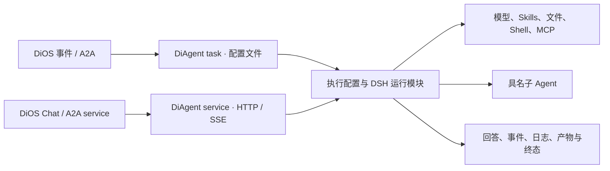

# DiAgent 职责清单与 TypeScript v0.1 兼容基线

2026-11-12。现状依据独立 DiAgent `12190ee`、DiOS `f2433d9`、DiOS 内嵌 DiAgent `5e22fb3` 的源码、样例和回归文档。部署镜像需另核对 digest。v0.1 指 TypeScript 重写版。 [架构设计](2026-11-diagent-dsh-architecture.md) · [DiOS 开发构建](https://github.com/HQIT/DiOS/blob/f2433d950925b773ae33e7c50cb0579dea1d4115/docker-compose.dev.yml) · [DiOS 镜像配置](https://github.com/HQIT/DiOS/blob/f2433d950925b773ae33e7c50cb0579dea1d4115/backend/app/config.py#L13)

## 1. 职责与发布范围

**DiAgent 按给定的模型、角色、Skills、工具和工作区执行一次 Agent 对话或任务，交付回答、工具事件、文件或明确的失败。** 一次运行可以委托内部子 Agent。跨 Agent 的事件路由与任务调度由 DiOS 管理。

| 所属 | 职责 |
| --- | --- |
| DiOS | 管 Agent 和资源配置、事件订阅与派发、容器、A2A 状态、Chat 展示历史和产物登记。签发及撤销适用的 MCP 授权。 |
| DiAgent | 接收 task 文件或 HTTP 请求，解析本次配置，启动和收尾 Agent 内核，维持输入、响应、日志与文件契约。 |
| DSH | 在新版中实现模型调用、Agent 循环、工具和 Skills、会话与子 Agent。HQIT 专属工具以插件注册。 |
| Docker | 提供 task/service 运行环境、挂载和外层隔离。DiOS 管容器，DiAgent 管容器内 DSH 子进程。 |

**v0.1 完整替换现有 DiAgent。** task 和 service 均使用 TypeScript + DSH，沿用 DiOS 的部署级镜像配置。一次性 Reviewer 任务用于验证替换契约，全量切换还须通过 service、SSE、HIL、会话和存量调用验收。独立入口按实际调用者确定迁移路径。旧 DeepAgents 镜像仅用于切换验证和回滚。 [DiOS 架构](https://github.com/HQIT/DiOS/blob/f2433d950925b773ae33e7c50cb0579dea1d4115/docs/architecture.md) · [DiAgent 构建入口](https://github.com/Zewang0217/DiAgent/blob/12190ee37befc633c5d302491bba89ea49da450d/app/core/builder.py#L29) · [DiOS A2A](https://github.com/HQIT/DiOS/blob/f2433d950925b773ae33e7c50cb0579dea1d4115/backend/app/services/a2a_service.py#L149)

## 2. DiOS 实际依赖的契约

| 路径 | 现有调用 | v0.1 底线 |
| --- | --- | --- |
| 容器与健康 | 两种镜像。service 监听 `8000`，DiOS 查 `GET /health` 是否返回 HTTP 200。task 容器按次启动，`TASK_CONFIG` 指向挂载文件。 | 两种镜像可在现有部署方式下启动。健康探针返回 200。收到停止信号时清理本次拥有的 DSH 执行。 |
| Chat | DiOS 用 DB 历史和新 user 消息组装 `messages`，发送 `model/stream`，有 Skills 时加 `tool_selection.tool_ids=["shell","publish_event"]`，可带 `custom_fields.reasoning`。当前转发没有 `session_id`。 | 保留 `POST /v1/chat/completions`、普通 JSON 和 SSE。验证角色、实际工具选择及完整文本历史。若采用 DSH 持久 Session，透传稳定 ID，并给旧会话及无 ID 调用提供兼容路径。 |
| A2A → service | 同一 Chat 接口，发一条 user 消息、`stream=false`、可选 `model`，读取 `choices[0].message.content` 写 artifact。 | 用实际请求做 fixture。缺模型时当前 Schema 可能拒绝；如新版允许缺省，要明确解析到哪个已配置模型并测试。 |
| 事件/A2A → task | DiOS 将 text/data parts 转成任务文本，生成 `/workspace/agent-task-{run_id}.json`，顶层 `models/task`。有网关授权时另写 per-run MCP 配置。 | 同一 JSON 在新镜像直接可读。执行一次，交付原位置的结果和可诊断退出状态。 |
| 工作区与配置 | `/workspace` 可写，`/workspace/skills` 和 `/workspace/cli` 只读。service 生成模型 YAML，按需生成 MCP JSON。 | 保持路径、读写权限和实际用到的 Bash、Git、curl 和 DiOS CLI 等运行依赖。CLI 场景需验证镜像中的 Python 命令可用。文件工具与 Shell 看到同一份文件。 |
| 任务完成 | DiOS 轮询容器，按退出码更新状态。读取 `output/events/{run_id}/task_result.md` 或其第一层子目录的结果；失败时附容器日志尾部。 | 成功时结果写入后退出 0。配置、模型和执行失败可定位并退出非零。重复运行的结果路径不互相覆盖。 |

源码：[service 启动与挂载](https://github.com/HQIT/DiOS/blob/f2433d950925b773ae33e7c50cb0579dea1d4115/backend/app/services/agent_runtime.py#L31) · [task 容器](https://github.com/HQIT/DiOS/blob/f2433d950925b773ae33e7c50cb0579dea1d4115/backend/app/services/docker_runner.py#L32) · [Chat 请求](https://github.com/HQIT/DiOS/blob/f2433d950925b773ae33e7c50cb0579dea1d4115/backend/app/api/apps/chat.py#L89) · [A2A service](https://github.com/HQIT/DiOS/blob/f2433d950925b773ae33e7c50cb0579dea1d4115/backend/app/services/a2a_service.py#L209) · [task 与产物](https://github.com/HQIT/DiOS/blob/f2433d950925b773ae33e7c50cb0579dea1d4115/backend/app/services/a2a_service.py#L287)

### HTTP、SSE 与 HIL

- 普通响应保留 OpenAI 风格 `chat.completion` 和 `id/object/created/model/choices`。DiOS 两条同步调用读取 `choices[0].message.content`；有可靠用量数据时返回 `usage`。
- SSE 使用 `text/event-stream`，正常结束发 finish chunk 与 `data: [DONE]`。最终文本通过 `choices[0].delta.content` 累积。当前无工具路径直接流式读模型，带工具路径会缓冲部分文本。前端还识别 `delta.reasoning_content`、`event: reasoning` 和 `event: status`。新版须用实际 UI 验证文本流粒度与事件顺序。
- 工具事件用 `event: tool_call`，分 `tool_call_start/end/error`。前端读取 `tool_name/tool_call_id`、开始的 `arguments`、结束的 `result/duration_ms`、失败的 `error`。DiOS 从结果提取 `pending_hil` 并发 `hil`。现有 HIL 由 DiOS CLI 工具结果驱动，DSH 原生审批需要显式映射才能兼容。HIL 结果需要保持可解析，通用截断应避开结构化审批字段。
- 流前错误走 HTTP；流中错误须被 DiOS 与前端识别。验证失败与部分文本的展示和持久化，终态只发送一次。

源码：[Chat route](https://github.com/Zewang0217/DiAgent/blob/12190ee37befc633c5d302491bba89ea49da450d/app/api/routes/chat.py#L16) · [响应格式](https://github.com/Zewang0217/DiAgent/blob/12190ee37befc633c5d302491bba89ea49da450d/app/core/response_formatter.py#L76) · [工具事件](https://github.com/Zewang0217/DiAgent/blob/12190ee37befc633c5d302491bba89ea49da450d/app/core/response_formatter.py#L293) · [DiOS SSE/HIL](https://github.com/HQIT/DiOS/blob/f2433d950925b773ae33e7c50cb0579dea1d4115/backend/app/api/apps/chat.py#L158) · [前端解析](https://github.com/HQIT/DiOS/blob/f2433d950925b773ae33e7c50cb0579dea1d4115/frontend/src/api/chat.ts#L98)

## 3. Agent 执行能力

| 能力 | 现有实现 | v0.1 底线 |
| --- | --- | --- |
| 模型 | 模型工厂按配置 key 解析 `provider/model/base_url/api_key`，有 OpenAI、vLLM OpenAI-compatible 与原生 Ollama。service 配置通常按真实模型名建 key，task 可用别名。 | 所有已使用模型按旧配置解析到正确端点与认证。验普通、流式、工具调用。OpenAI-compatible 作为首批；已用原生 Ollama 纳入切换验收。 |
| 角色与输入 | task 使用指定 system prompt 或默认 prompt，并附产物路径。带工具的 service 合并 system 消息。无工具时直接调用模型。 | 角色、历史、任务输入和产物目录真正生效。保留无工具问答能力，明确 DSH profile 的默认角色和工具。 |
| 循环与预算 | Deep Agents 编排多步模型和工具，带工具的 service 与 task 使用 `recursion_limit`。 | DSH 完成多步任务，区分成功、失败、超时和预算耗尽。给已下发预算定义可测试的行为映射。 |
| MCP | 读取多服务器 JSON，发现工具，按名称选择。task 支持配置相对 workspace、stdio 的相对 `cwd`，工具失败可返回模型可读错误。DiOS enforce 为支持的 task `streamable_http` 下发授权。 | 至少验真实 `streamable_http` 连接、headers、工具发现与调用、允许/拒绝/不可用。已用的 stdio/SSE 等传输列入迁移清单。失败保持原授权边界。 |
| 工具选择 | service 只启用选中的 MCP 工具，`shell/publish_event` 需显式选中。task 默认加入这两个内置工具。主 task 的 `tools=None` 选全部 MCP，`tools=[]` 在代码中选空。 | 按模式与配置生成实际工具集合。验证缺省、空列表、具名选择、内置工具与禁用工具。工具可见性以模型收到的 schema 为准。 |
| Skills | task 按 `skills_dir/skill_names` 装配，名单为空或未给时使用整个目录。service 只有在选到工具时才进入 Agent 路径，该路径使用共享技能目录。DiOS Chat 仅根据 Skills 是否为空追加工具 ID，未传具体 Skill 名单。 | 现有 `SKILL.md` 与附属文件可用。验证具名 Skill 真正加载，工具权限仍由实际运行配置决定。 |
| 文件与 Shell | Deep Agents 提供文件读写、编辑、搜索等工具。`shell(command,cwd?,timeout?)` 在容器内运行登录 Bash，默认 `/workspace`、300 秒，返回退出码和有界 stdout/stderr。 | Linux task 提供兼容名称、参数和结果格式，命令由 DSH Bash 前台执行。已验证相对工作目录、非零退出码、stdout/stderr、超时和 `GIT_PLATFORM_TOKEN` 的显式注入范围。依赖登录环境、输出截断顺序或其他业务凭据的存量调用，以及 service 的工具选择，仍须验收。 |
| `publish_event` | 输入 `event_type/source/subject/data`。查事件目录、source pattern，再 POST DiOS `/api/os/events/manual`，返回事件 ID、状态或拒绝/失败文本。 | HQIT 插件保留工具名、参数和成功/拒绝行为。验证一次发布和一条拒绝，并在实际使用的 DiOS 鉴权模式下验收。路由仍由 DiOS 管理。 |
| 内部子 Agent | task 可配置具名子 Agent、描述、角色、模型、工具、MCP、Skills 和可选任务说明。主子 Agent 收到同一产物目录提示。独立样例使用 researcher、writer、reviewer，DiOS 可下发 subagents。 | 核实存量调用。存在依赖时纳入 task 兼容验收，验证角色、工具授权、Skill 和产物。新的多 Agent 共用容器方案列为后续方向。 |
| 日志与产物 | task 在输出根下为每次运行建子目录，写结果、过程日志和附加文件。DiOS 消费 Markdown 与容器日志。 | 保持结果路径及文件编码，日志能定位模型、失败工具与终态。验证附加文件和两次运行各自结果。观察中断后避免重复调用有副作用的工具。 |

源码：[模型工厂](https://github.com/Zewang0217/DiAgent/blob/12190ee37befc633c5d302491bba89ea49da450d/app/llm/factory.py#L13) · [service 执行](https://github.com/Zewang0217/DiAgent/blob/12190ee37befc633c5d302491bba89ea49da450d/app/core/agent.py#L106) · [task runner](https://github.com/Zewang0217/DiAgent/blob/12190ee37befc633c5d302491bba89ea49da450d/app/task/runner.py#L173) · [MCP 客户端](https://github.com/Zewang0217/DiAgent/blob/12190ee37befc633c5d302491bba89ea49da450d/app/mcp/client.py#L17) · [工具选择](https://github.com/Zewang0217/DiAgent/blob/12190ee37befc633c5d302491bba89ea49da450d/app/mcp/tool_registry.py#L46) · [Shell](https://github.com/Zewang0217/DiAgent/blob/12190ee37befc633c5d302491bba89ea49da450d/app/tools/shell_tool.py#L15) · [事件工具](https://github.com/Zewang0217/DiAgent/blob/12190ee37befc633c5d302491bba89ea49da450d/app/tools/publish_event_tool.py#L53) · [MCP 网关](https://github.com/HQIT/DiOS/blob/f2433d950925b773ae33e7c50cb0579dea1d4115/backend/app/services/e2ag_tool_gateway.py#L118) · [子 Agent 样例](https://github.com/Zewang0217/DiAgent/blob/12190ee37befc633c5d302491bba89ea49da450d/workspace/agent-task.json#L37) · [DiOS 回归](https://github.com/HQIT/DiOS/blob/f2433d950925b773ae33e7c50cb0579dea1d4115/docs/regression-master-diagent.md)

## 4. 配置、状态与生命周期

| 范围 | 现有语义及迁移要求 |
| --- | --- |
| Task 输入 | `TASK_CONFIG` 必填。DiOS 用 JSON，独立入口也读 YAML。当前稳定样例为顶层 `task` 对象与可选 `models/app`。`models.default_model`、`models.models`、`task.model` 和 `app.LLM_DEFAULT_MODEL` 决定模型解析。文档声明的 flat 形式与 `task` 字符串字段冲突，解析器会将同名键作为嵌套对象处理。fixture 先使用真实结构。 |
| Task 执行配置 | `task.task/system_prompt/temperature/workspace/skills_dir/skill_names/mcp_config_path/tools/subagents` 和运行预算。新版一次性任务的每轮模型请求使用配置温度，省略时沿用旧版默认值 `0.7`，支持显式 `0`。MCP 路径省略时尝试默认配置，显式空字符串关闭，提供相对路径时按 workspace 解析。 |
| Task 输出配置 | `OUTPUT_DIR` 优先于 `task.output_dir`；配置中的相对目录按 workspace 解析；都缺省时用当前目录。每次运行在根目录下另建子目录。文件名由 `output.log_file/result_file` 控制，独立默认结果 `task_result.txt`，DiOS 指定 `task_result.md`。 |
| Task 触发 | DiOS 下发 `once`。独立版还有 cron 和 interval，环境变量 `TRIGGER_MODE/CRON/INTERVAL_SECONDS` 可覆盖。现有周期模式先执行再等待。 |
| Service 环境 | `AGENT_WORKSPACE/LLM_MODELS_CONFIG_PATH/LLM_DEFAULT_MODEL/MCP_CONFIG_PATH/AGENT_SYSTEM_PROMPT/SKILLS_DIR/DIOS_API` 与业务环境。DiOS 启容器时写入模型及 MCP 文件，运行中的配置变更如何生效需明确。 |
| Service 会话 | 独立 service 带 `session_id` 时拼接内存历史并写回最后一条 user 与回答，默认 TTL、LRU 和历史条数上限。DiOS Chat 由 DB 重放。新版若让 DSH 保存上下文，需验证旧会话、无 ID 请求、并发与恢复，避免重复追加历史。 |
| Task checkpoint | 独立 `12190ee` 可用 `thread_id` 将 LangGraph SQLite 写到 `workspace/.checkpoints/`；DiOS 内嵌 `5e22fb3` 没有。若有实际 checkpoint 用户，验证旧运行收尾、新运行续接及旧数据处理。 |
| 失败与停止 | 缺配置或非法触发模式会退出非零。运行异常可写失败日志与结果。新版要测试容器停止信号能收尾 DSH。当前 DiOS A2A 取消主要写状态、撤销授权，尚未停止容器，轮询可能写回终态。真正 A2A 取消需 DiOS 联动。 |

依据：[Task Schema](https://github.com/Zewang0217/DiAgent/blob/12190ee37befc633c5d302491bba89ea49da450d/app/task/config_schema.py#L67) · [Task 入口](https://github.com/Zewang0217/DiAgent/blob/12190ee37befc633c5d302491bba89ea49da450d/app/task/entrypoint.py#L23) · [触发](https://github.com/Zewang0217/DiAgent/blob/12190ee37befc633c5d302491bba89ea49da450d/app/task/triggers.py#L13) · [任务输出](https://github.com/Zewang0217/DiAgent/blob/12190ee37befc633c5d302491bba89ea49da450d/app/task/runner.py#L343) · [service env](https://github.com/Zewang0217/DiAgent/blob/12190ee37befc633c5d302491bba89ea49da450d/app/config.py#L11) · [会话存储](https://github.com/Zewang0217/DiAgent/blob/12190ee37befc633c5d302491bba89ea49da450d/app/session/store.py#L16) · [checkpoint](https://github.com/Zewang0217/DiAgent/blob/12190ee37befc633c5d302491bba89ea49da450d/app/core/checkpoint.py#L23) · [A2A 取消](https://github.com/HQIT/DiOS/blob/f2433d950925b773ae33e7c50cb0579dea1d4115/backend/app/services/a2a_service.py#L554)

## 5. 独立入口与已知行为缺口

**独立使用清单。** 当前 DiOS 主要链路经 A2A 与 Chat，以下能力在 DiAgent 源码中存在，外部调用量待核实。若有在用调用者，需保留接口或安排旧入口收尾。

| 能力 | 当前行为 |
| --- | --- |
| `POST /v1/events` | 接收 CloudEvent，将类型、来源、主题、时间和 data 转成一条用户消息，返回 `status/event_id/response`。当前 DiOS 事件派发走 A2A。 |
| `GET /v1/tools` | 返回发现的 MCP 工具元数据及 total。 |
| `GET /v1/sessions`、`GET/DELETE /v1/sessions/{id}` | 列表、读取、删除独立 service 的内存历史，缺失的指定会话返回 404。 |
| 独立运行 | 根路径、FastAPI 文档、Compose、YAML、cron/interval、可选 task checkpoint。当前 DiOS 管理模式以两条正式入口为切换优先级。 |

依据：[事件 route](https://github.com/Zewang0217/DiAgent/blob/12190ee37befc633c5d302491bba89ea49da450d/app/api/routes/events.py#L42) · [工具 route](https://github.com/Zewang0217/DiAgent/blob/12190ee37befc633c5d302491bba89ea49da450d/app/api/routes/tools.py#L10) · [会话 route](https://github.com/Zewang0217/DiAgent/blob/12190ee37befc633c5d302491bba89ea49da450d/app/api/routes/sessions.py#L10) · [DiOS 事件派发](https://github.com/HQIT/DiOS/blob/f2433d950925b773ae33e7c50cb0579dea1d4115/backend/app/services/event_dispatcher.py#L267)

| 字段或行为 | 当前证据 | 迁移处理 |
| --- | --- | --- |
| `temperature=0` | service 用 `request.temperature or 0.7`。 | 对支持的模型，保留显式 0。 |
| `top_p/stop/max_tokens/tool_selection.tool_config` | Schema 接受。service 调用只传温度，`max_tokens` 进预处理对象但未传入模型构造，工具配置未接执行。 | 记录实际用到的字段及支持状态，显式预算不能落实时给出具体错误。 |
| `user_id/user_context`、Redis、Skills 文件上限 | 字段或依赖存在。当前会话用内存，用户上下文未形成授权，Skills 文件上限未见执行接线。 | 以可观察行为验收。由可信配置和 DiOS 网关落实授权。 |
| `role=tool`、历史 tool_calls | HTTP Schema 接受，带工具路径转换仅保留 system/user/assistant 文本。无工具 adapter 有 tool message 转换。 | 先覆盖 DiOS 文本历史。工具历史往返按实际独立调用验收。 |
| `max_tool_rounds`、middleware | Python task 透传轮次字段，未证实底层执行限制。middleware 可按名称过滤，选项未见生效。 | DSH task 按尝试调用工具的模型步骤计数，同一步的多个调用共享额度。超额调用在派发前拒绝，模型可继续完成回答。middleware 配置仍待兼容。 |
| A2A service 的角色和工具 | 只发 user 消息且无 tool selection；无工具路径可能绕过默认角色、Skills。 | 用实际 A2A fixture 明确并测试新版行为。 |

依据：[预处理](https://github.com/Zewang0217/DiAgent/blob/12190ee37befc633c5d302491bba89ea49da450d/app/core/preprocessor.py#L36) · [HTTP Schema](https://github.com/Zewang0217/DiAgent/blob/12190ee37befc633c5d302491bba89ea49da450d/app/schemas/extended_request.py#L23) · [带工具路径的消息转换](https://github.com/Zewang0217/DiAgent/blob/12190ee37befc633c5d302491bba89ea49da450d/app/core/agent.py#L377) · [通用消息转换](https://github.com/Zewang0217/DiAgent/blob/12190ee37befc633c5d302491bba89ea49da450d/app/llm/base.py#L57) · [运行预算](https://github.com/Zewang0217/DiAgent/blob/12190ee37befc633c5d302491bba89ea49da450d/app/task/runner.py#L285)

## 6. v0.1 验收用例

用同一组脱敏配置、输入和模型分别跑现有镜像与新镜像。比较配置生效、工具调用、文件、状态和协议。模型自然语言表述允许不同。

| 编号 | 场景 | 通过条件 |
| --- | --- | --- |
| 1 | DiOS once task 换镜像 | 现有 JSON 可读，模型和角色正确，使用一个 Skill、一个只读 MCP 与 Shell。DiOS 从原路径读出报告并登记 artifact。 |
| 2 | 存量具名子 Agent 配置 | 有存量调用时，指定角色、Skill 与获准工具实际生效，任务结果和附加文件均可回收。 |
| 3 | 工具授权与事件 | 测试事件发布一次。非法类型/source 与 MCP 网关拒绝有可读反馈，未授权调用无对应业务结果。 |
| 4 | 失败和停止 | 缺配置、模型失败、MCP 失败、超时可区分。容器停止时 DSH 子进程退出。观察中断不重复触发已有工具操作。 |
| 5 | 普通 Chat 与 A2A service | 健康探针通过，非流式响应可被解析。模型和角色选择有证据，缺配置的失败可定位。 |
| 6 | SSE、工具与 HIL | 前端显示回答和工具开始、结束、失败。DiOS 能解析 HIL。成功正常结束，异常无成功误报。 |
| 7 | 多轮与并发 | 第二轮可引用历史，两个并发会话隔离。采用持久会话时，验证重启恢复及历史迁移。 |
| 8 | 存量配置与回滚 | 已用模型、MCP、独立入口和配置通过迁移清单。按部署恢复旧镜像，在途任务由原执行方收尾。 |

**用例 1–4 通过后可交付 task 试用。用例 5–8 及现有使用清单通过后，才具备全量 v0.1 替换条件。** 本次只核查源码和既有文档。生产镜像、外部调用者、目标 DSH 的运行效果待验证。产品代码未改动。
