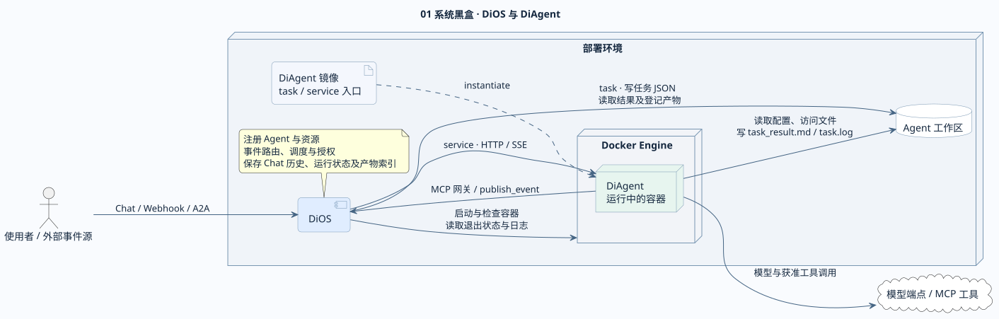
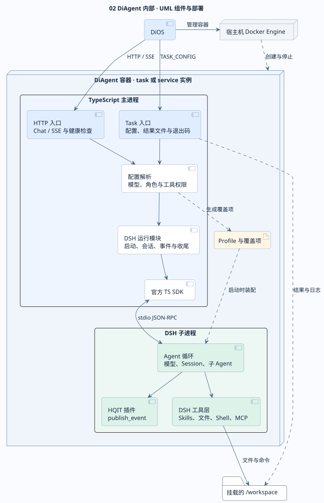
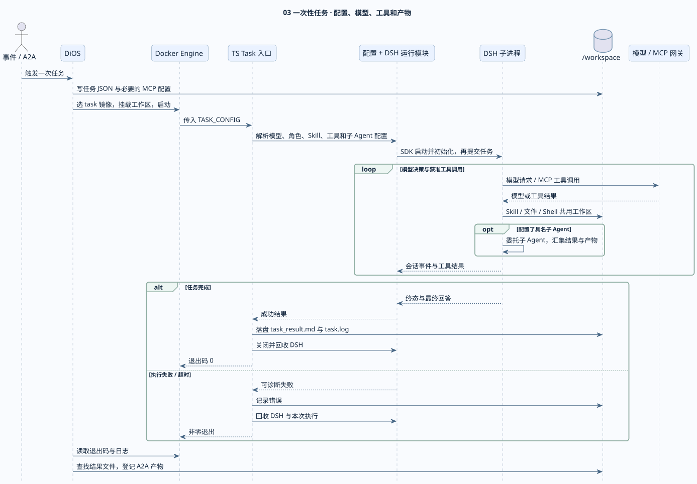
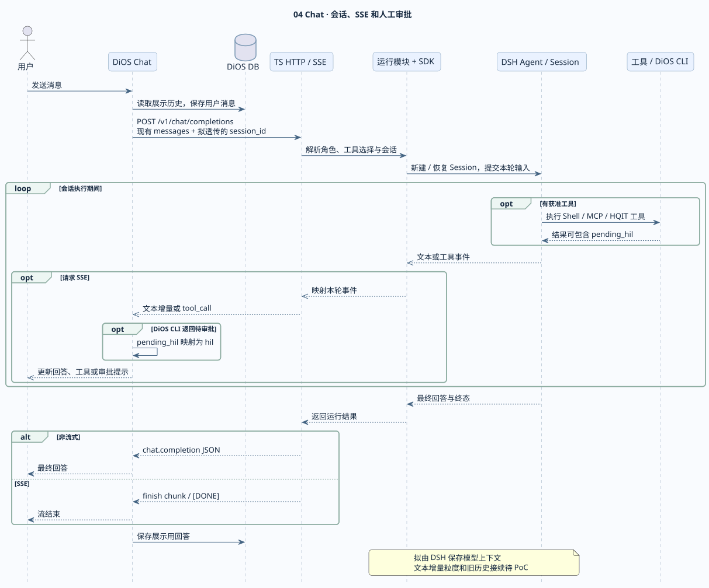
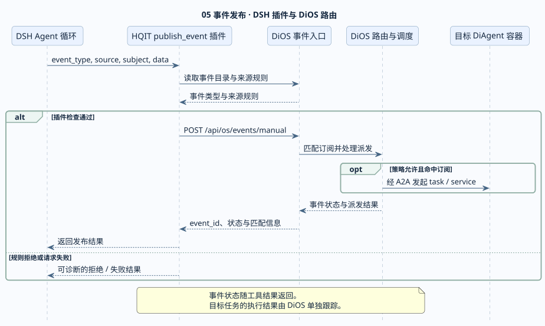
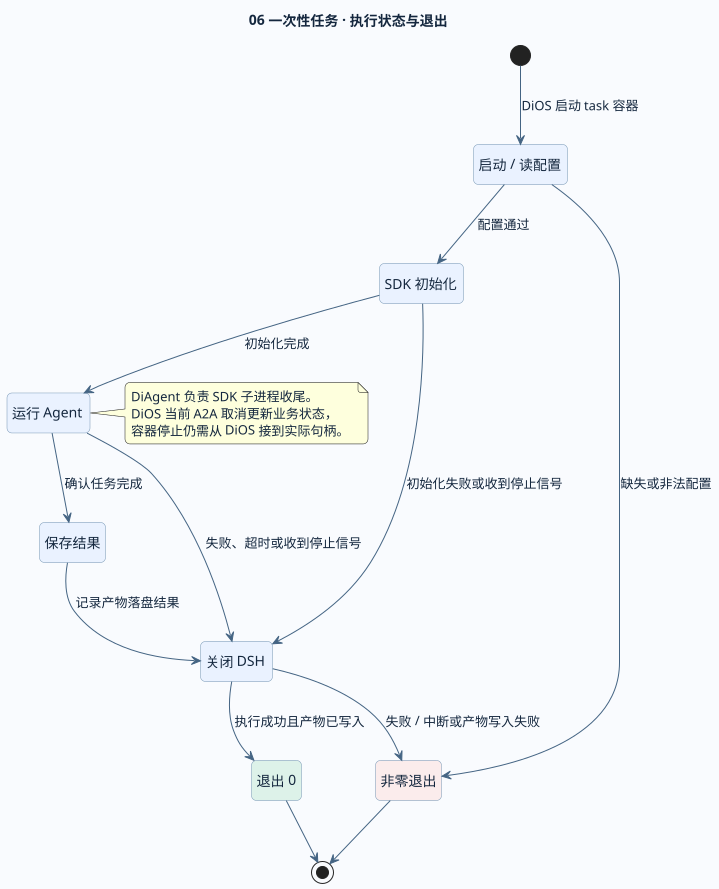

# DiOS 与 DiAgent v0.1 系统设计图

图中使用 TypeScript DiAgent + DSH SDK + Docker 的拟议设计。现有 DiOS 调用契约和兼容要求来自 [v0.1 职责基线](2026-11-diagent-v0.1-compatibility-baseline.md)，实现决策见 [TypeScript DiAgent 架构](2026-11-diagent-dsh-architecture.md)。

## 1. 系统黑盒

**DiOS 决定运行哪个 Agent、何时运行、它可以用什么，记录运行状态与产物。DiAgent 按配置完成一次任务或一次对话。** DiOS 通过 Docker Engine 启动和管理容器。Task 模式经共享工作区交付配置和文件，以容器退出码表明结果。Service 模式经 HTTP/SSE 交互。

DiAgent 是交付单元，包含 TypeScript 入口、SDK、固定版本的 DSH、profile 和 HQIT 插件，以 Docker 镜像交付。图中的 Docker Engine 属于宿主部署层，容器内部是应用和 DSH 进程。两种入口使用同一套代码，按各自的镜像入口运行。工作区仍沿用现有 DiOS 的 Agent 级挂载约定。 [DiOS service 启动](https://github.com/HQIT/DiOS/blob/f2433d950925b773ae33e7c50cb0579dea1d4115/backend/app/services/agent_runtime.py#L81) · [DiOS task 启动](https://github.com/HQIT/DiOS/blob/f2433d950925b773ae33e7c50cb0579dea1d4115/backend/app/services/docker_runner.py#L32)

[SVG](diagent-v0.1-diagrams/01-system.svg) · [PlantUML](diagent-v0.1-diagrams/01-system.puml)

## 2. DiAgent 内部 UML 组件图

| 模块 | 职责 |
| --- | --- |
| **Task 入口** | 读取 `TASK_CONFIG`，驱动一次运行，写日志、最终答案和退出状态。 |
| **HTTP 入口** | 提供 `/health`、Chat JSON 与 SSE。把内部事件转换成 DiOS 和前端消费的响应。 |
| **配置解析** | 将模型、角色、工作区、Skills、MCP、工具选择和预算转换为本次生效配置。生成必要的 profile 覆盖项。 |
| **DSH 运行模块** | 封装 SDK 的启动与收尾、会话定位、通知订阅、等待终态和错误归类。Task 与 HTTP 共用。 |
| **官方 TS SDK** | 在 TypeScript 主进程启动 DSH 子进程，通过 stdio JSON-RPC 传递请求与事件。 |
| **DSH 子进程** | 按 profile 装配模型、会话、循环、Skills 和工具，执行模型决策、MCP、文件和命令。 |
| **HQIT 插件** | 在 DSH 进程内注册 `publish_event` 等产品专属工具，按 DiOS 契约返回结果。 |
| **Docker / 工作区** | Docker Engine 管容器，工作区提供挂载的配置、只读 Skills/CLI、输入与输出。文件工具与 Shell 使用同一工作区。 |

图中的实线表示主要运行调用，虚线表示创建、装配或文件依赖。工作区、模型端点、MCP 网关和事件入口各有独立生命周期，具体交互在下方展开。

[SVG](diagent-v0.1-diagrams/02-components.svg) · [PlantUML](diagent-v0.1-diagrams/02-components.puml)

## 3. 一次性任务、工具和子 Agent

DiOS 写任务和授权配置，Docker 传入 `TASK_CONFIG`，DiAgent 经 SDK 驱动 DSH。DSH 加载选中的 Skill，调用模型和获准工具。文件、Shell 和具名子 Agent 在约定的工作区协作。最终回答和日志由 Task 入口落盘，DiOS 通过退出码和文件登记结果。子 Agent 的配置映射、MCP 授权和实际产物路径是 task 镜像的验收点。 [配置生成及产物读取](https://github.com/HQIT/DiOS/blob/f2433d950925b773ae33e7c50cb0579dea1d4115/backend/app/services/a2a_service.py#L287)

[SVG](diagent-v0.1-diagrams/03-task-sequence.svg) · [PlantUML](diagent-v0.1-diagrams/03-task-sequence.puml)

## 4. Chat、会话和 SSE

采用拟议的 `session_id` 透传方案。DiOS 保存展示历史，DSH 保存模型会话上下文，DiAgent 按会话映射文本与工具事件。现有 DiOS 会发完整历史且内部请求缺少会话 ID。旧历史接续及 SDK 事件能否满足实时 SSE 仍需 PoC。CLI 返回的 `pending_hil` 由 DiOS 映射为 `hil`，验收时要保留这条行为。 [DiOS Chat 转发](https://github.com/HQIT/DiOS/blob/f2433d950925b773ae33e7c50cb0579dea1d4115/backend/app/api/apps/chat.py#L139)

[SVG](diagent-v0.1-diagrams/04-chat-sequence.svg) · [PlantUML](diagent-v0.1-diagrams/04-chat-sequence.puml)

## 5. 从一个 Agent 发布事件到另一个 Agent

DSH 选择 `publish_event` 后由 HQIT 插件调用 DiOS。DiOS 校验、匹配订阅并处理派发，经 A2A 启动目标 Agent。插件把事件状态返回给当前 Agent，目标 Agent 的运行状态和产物由 DiOS 独立跟踪。此能力贯通工具调用、DiOS 路由和下一次执行。 [现有事件工具](https://github.com/Zewang0217/DiAgent/blob/12190ee37befc633c5d302491bba89ea49da450d/app/tools/publish_event_tool.py#L53) · [DiOS 手动事件](https://github.com/HQIT/DiOS/blob/f2433d950925b773ae33e7c50cb0579dea1d4115/backend/app/api/os/events.py#L128) · [事件派发](https://github.com/HQIT/DiOS/blob/f2433d950925b773ae33e7c50cb0579dea1d4115/backend/app/services/event_dispatcher.py#L267)

[SVG](diagent-v0.1-diagrams/05-event-sequence.svg) · [PlantUML](diagent-v0.1-diagrams/05-event-sequence.puml)

## 6. Task 状态与停止

这是拟议的容器内执行状态。确认运行完成、产物写入并收尾后才退出 0。失败、超时和中断进入非零终态。DiOS 读退出码更新业务状态。当前 A2A 取消会改状态并撤销授权，真实停止还需要将取消接到对应容器。 [DiOS 轮询](https://github.com/HQIT/DiOS/blob/f2433d950925b773ae33e7c50cb0579dea1d4115/backend/app/services/a2a_service.py#L360) · [DiOS 取消](https://github.com/HQIT/DiOS/blob/f2433d950925b773ae33e7c50cb0579dea1d4115/backend/app/services/a2a_service.py#L554)

[SVG](diagent-v0.1-diagrams/06-task-lifecycle.svg) · [PlantUML](diagent-v0.1-diagrams/06-task-lifecycle.puml)
