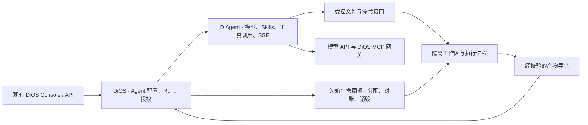

# DiOS / DiAgent 沙箱调研与重构方案

2026-11-12 · 本地基线 DiOS `f2433d9`、独立 DiAgent `12190ee`、DiOS 内嵌 DiAgent `5e22fb3`。首版按仓库路线图的单机、单实例、可信操作者范围设计。底座比较以各产品的官方公开信息为准。 [DiOS 路线图](https://github.com/HQIT/DiOS/blob/f2433d950925b773ae33e7c50cb0579dea1d4115/ROADMAP.md#L9) · [前一份 DSH 可行性分析](2026-11-diagent-dsh-feasibility.md)

## 1. 最终要做什么

**交付一个可随 DiOS 在 Linux 单机部署的 Agent 执行系统。** 操作者从 DiOS 提交聊天或任务，DiAgent 负责模型推理与工具调用。需要文件和 shell 的运行按需取得独立工作区，由沙箱执行。操作者能查询状态、取消运行、拿到产物。DiOS 或执行器重启后，系统能对账运行状态并回收遗留资源。

建议保留现有 Python/Deep Agents 内核，先改造任务链路。**底座先验证 OpenSandbox + Docker 单机部署，验证通过就复用 OpenSandbox 的生命周期和 execd。** 将目前的 Docker 直连作为对照和迁移回滚路径。若选定版本在隔离、取消、产物或部署成本上达不到验收条件，首版改用现有 Docker 管理逻辑实现一套最小后端。两条路径共用 DiAgent 的文件/命令接入点及 DiOS 的运行记录。

底座验证成功后，再逐步覆盖 Chat/SSE。DSH 可在运行契约稳定后作为第二种 Agent 内核验证。若部署范围扩大到陌生用户提交任意代码、外部租户共机或高敏数据，先验证 gVisor 或 VM 级隔离及网络、凭据、数据权限，再开放对应工作负载。

## 2. 大厂和沙箱平台怎么做

| 产品与场景 | 官方公开的底座或边界 | HQIT 可以借鉴 |
| --- | --- | --- |
| OpenAI Codex Cloud | 官方系统卡披露 OpenAI 托管的隔离容器，运行阶段默认禁网，可按环境配置联网。当前 Cloud 帮助文档说明每任务使用独立工作区，并公开可恢复的 VM 状态。两份资料描述不同阶段的产品行为，具体 OCI runtime、虚拟化实现及嵌套关系未披露。 [Codex 系统卡](https://cdn.openai.com/pdf/ac7c37ae-7f4c-4442-b741-2eabdeaf77e0/oai_5_2_Codex.pdf) · [Codex Cloud](https://help.openai.com/en/articles/20001545-using-codex-cloud) | 将环境准备与任务执行分开。每次任务单独分配工作区并设定联网规则。 |
| OpenAI 前沿模型训练 | 工程披露 Linux 上在轻量 microVM 内运行受限容器；也有 macOS/Windows 虚拟环境及 GPU 容器。该披露面向训练基础设施。 [工程披露](https://openai.com/index/securing-our-frontier-model-training-environment/) | 容器与 microVM 可以组合。具体隔离层取决于工作负载和风险。 |
| Anthropic Claude | claude.ai 代码执行披露使用每会话的临时 gVisor 容器。Claude Code 本地用 OS 级文件与网络限制，Web/Cloud 版官方文档描述云 VM 与独立会话，具体虚拟化实现未披露。Managed Agents 云端公开为每会话 Linux 容器，Agent 循环、会话历史和 Vault 位于沙箱外，也支持客户自托管工具执行。 [跨产品隔离](https://www.anthropic.com/research/how-we-contain-claude) · [Claude Code Web](https://code.claude.com/docs/en/claude-code-on-the-web) · [Managed Agents](https://platform.claude.com/docs/en/managed-agents/secure-deployment-risks) | 最贴近本项目的架构参照是 Managed Agents：会话、Agent 循环和执行环境各有生命周期。 |
| GitHub Copilot | 默认 Cloud 路径按会话提供隔离 Linux 环境，停止时保留快照。Actions 是另一个选项，可用 GitHub 托管或自托管 runner。托管 Actions runner 多数是独立 VM，单 CPU 规格是共享 VM 内的容器。Cloud 默认路径的底层隔离实现未在该文档披露。 [Cloud sandboxes](https://docs.github.com/en/copilot/concepts/security-governance-and-network-settings/about-cloud-sandboxes) · [Actions 环境](https://docs.github.com/en/copilot/how-tos/copilot-on-github/customize-copilot/customize-cloud-agent/customize-the-agent-environment) · [托管 Actions runner](https://docs.github.com/en/actions/concepts/runners/github-hosted-runners) | 工作区可以独立于在线执行实例保留。已有 CI 环境也能成为一种执行路径。 |
| Google Gemini / Google Cloud | Gemini CLI 本地支持 Docker/Podman、macOS Seatbelt 和 Linux runsc 等。Gemini Enterprise Managed Agents 预览文档公开隔离 Linux 执行容器及出站允许列表。Jules 按任务分配短期 VM。GKE Agent Sandbox 可明确选择 gVisor，属于另一条部署产品线。 [Gemini CLI](https://github.com/google-gemini/gemini-cli/blob/main/docs/cli/sandbox.md) · [Managed Agents](https://docs.cloud.google.com/gemini-enterprise-agent-platform/build/managed-agents/sandbox-environment) · [Jules VM](https://jules.google/docs/environment/) · [GKE](https://docs.cloud.google.com/kubernetes-engine/docs/how-to/how-install-agent-sandbox) | 开发机、托管产品和集群部署可以各用合适的隔离层。 |
| AWS Bedrock AgentCore | Code Interpreter 明确为每个工具会话分配专用 microVM，并按超时回收。AgentCore Runtime 也公开有按会话分配的 microVM 模式，另有 EC2 Instances 模式。 [Code Interpreter 会话](https://docs.aws.amazon.com/bedrock-agentcore/latest/devguide/code-interpreter-session-characteristics.html) · [Runtime 会话](https://docs.aws.amazon.com/bedrock-agentcore/latest/devguide/runtime-sessions.html) · [Instances](https://docs.aws.amazon.com/bedrock-agentcore/latest/devguide/runtime-instances-how-it-works.html) | 区分工具会话与 Agent 运行。把空闲时间、最长寿命、关闭后的文件保留纳入契约。 |
| 阿里云 Agent Sandbox / OpenSandbox | 阿里云 ACS Agent Sandbox 公开为 microVM 级隔离的托管服务。开源 OpenSandbox 管理实例和执行接口，单机可以用 Docker，集群可以用 Kubernetes，并可按部署模式接 gVisor、Kata 或 Firecracker 相关运行方案。公开资料分别描述这两项产品。 [阿里云 ACS](https://www.alibabacloud.com/help/en/cs/user-guide/agent-sandbox/) · [OpenSandbox 架构](https://github.com/opensandbox-group/OpenSandbox/blob/main/docs/architecture/index.md) · [运行时部署](https://github.com/opensandbox-group/OpenSandbox/blob/main/docs/guides/secure-container.md) | 复用沙箱管理层，隔离级别由实际 runtime 配置决定。 |
| E2B | 官方说明每个 Agent 会话在独立的 Firecracker microVM 内。 [E2B 隔离](https://e2b.dev/enterprise) | 如需直接获得托管 microVM，可评估供应商接口、网络和数据边界。 |

这里有三层选择。**镜像与调度**可用 Docker 或 Kubernetes。**执行隔离**可用常见的 runc 共享内核容器、gVisor 用户态内核或使用独立 guest kernel 的 VM 路线。**沙箱管理**处理创建、文件、命令、过期和回收，OpenSandbox 位于这层。Docker Engine 默认用 runc，也能配置其他 OCI runtime；Firecracker 是基于 KVM 的 VMM。因而「OpenSandbox + Docker + gVisor」是可验证的一种组合，「用了 Docker 镜像」只能说明交付形式。 [Docker runtime](https://docs.docker.com/engine/daemon/alternative-runtimes/) · [gVisor](https://github.com/google/gvisor/blob/master/g3doc/README.md) · [Firecracker](https://firecracker-microvm.github.io/) · [OpenSandbox 安全运行时](https://github.com/opensandbox-group/OpenSandbox/blob/main/docs/guides/secure-container.md)

**与 HQIT 最接近的两条参照。** Claude Managed Agents 将会话、推理循环和沙箱独立管理。OpenAI Agents API 的自托管方案也由托管 harness 发起工具调用，客户环境中的 executor 负责文件与命令，应用密钥和环境接入凭据分开。这两个公开接口支持把 DiAgent 的执行环境从推理进程中抽出来。 [Anthropic 架构](https://www.anthropic.com/research/managed-agents) · [OpenAI 自托管 executor](https://developers.openai.com/api/docs/guides/agents-api/environments/self-hosted)

## 3. 选择底座的条件

| 候选 | 适用场景 | HQIT 仍要实现或验证 |
| --- | --- | --- |
| OpenSandbox + Docker | 首选 PoC。复用单机实例管理、TTL、Python SDK、execd 文件与命令接口。 | 额外服务与镜像的部署维护。锁定发行版本，实测命令中止、沙箱销毁、掉线后重新连接、资源限制、出站策略和 execd 的服务间认证。 |
| Docker 直连 | 已有依赖和运维经验，适合建立对照，也可作为首版备选。 | 可信侧需实现创建与对账、TTL、文件传输、有界命令、并发及回收。重点比较这些代码和维护成本。 |
| Docker + gVisor | 单机提升隔离的优先实验。复用 OCI 镜像和大部分接入方式。 | 目标 Linux 主机支持、常用命令与库的兼容性、文件 I/O、网络组合与性能。OpenSandbox 的 egress upstream proxy 指南明确列出 gVisor 组合的限制，需在候选版本用实际策略验证。 |
| Kata、Firecracker 或托管 microVM | 当风险等级要求独立 guest kernel，或需要托管容量时再选。 | 宿主虚拟化、镜像或快照、网络、产物持久化、运维成本。自建方案优先评估成熟编排。托管方案额外核对数据驻留、私网与费用。 |

依据：[OpenSandbox Docker 实现说明](https://github.com/opensandbox-group/OpenSandbox/blob/main/docs/architecture/index.md#41-docker-runtime) · [execd](https://github.com/opensandbox-group/OpenSandbox/blob/main/docs/architecture/data-plane/execd.md) · [Python SDK](https://github.com/opensandbox-group/OpenSandbox/blob/main/docs/sdks/python.md) · [出站兼容矩阵](https://github.com/opensandbox-group/OpenSandbox/blob/main/docs/guides/egress-upstream-proxy.md)

**PoC 的底座退出条件。** 用同一个镜像和任务测试创建/销毁、两个并行工作区、命令及子进程取消、最大寿命、资源配额、网络策略、产物导出、服务重启重连。量出冷启动和热镜像启动的 P50/P95、首条工具事件延时、并发峰值内存及清理失败数。双方按相同验收项比较。PoC 可从 OpenSandbox 稳定版 1.2.0 开始。锁定配套 Server/execd/SDK 版本和镜像 digest，并复核对应发行版文档。 [OpenSandbox 1.2.0](https://github.com/opensandbox-group/OpenSandbox/releases/tag/release-1.2.0)当前没有真实测量，性能门槛应依据基线和实际任务目标确定。

## 4. 重构哪些东西

| 改造点 | 当前代码 | 目标行为 |
| --- | --- | --- |
| DiOS 的运行记录与取消 | `A2ATask` 表示任务。运行由后台协程轮询，service 的 `AgentRuntime` 记录容器；取消主要写状态和撤销部分授权。 | 首版复用或关联现有任务 ID，持久化运行与沙箱句柄、配置快照、阶段、终止原因和产物。取消先记录意图，再停止 Agent 调用及实际执行，最后根据确认结果落终态。启动后对账未结束运行。 [现有模型](https://github.com/HQIT/DiOS/blob/f2433d950925b773ae33e7c50cb0579dea1d4115/backend/app/models/tables.py#L117) · [轮询](https://github.com/HQIT/DiOS/blob/f2433d950925b773ae33e7c50cb0579dea1d4115/backend/app/services/a2a_service.py#L360) · [取消](https://github.com/HQIT/DiOS/blob/f2433d950925b773ae33e7c50cb0579dea1d4115/backend/app/services/a2a_service.py#L554) |
| Docker 生命周期调用 | service 懒启动、task 按次启动。DiOS 直接调用 Docker SDK 并挂载 Agent 工作区。 | 先保留 service/task 的启动入口。为新路径封装按 run 分配、查询和回收；可信生命周期管理模块持有 Docker 权限。DiAgent 只拿当前工作区所需的短期访问权限。 [service](https://github.com/HQIT/DiOS/blob/f2433d950925b773ae33e7c50cb0579dea1d4115/backend/app/services/agent_runtime.py#L81) · [task Docker runner](https://github.com/HQIT/DiOS/blob/f2433d950925b773ae33e7c50cb0579dea1d4115/backend/app/services/docker_runner.py#L32) |
| DiAgent 的文件和 shell | `FilesystemBackend` 直接读写本地路径；`shell_tool` 在 DiAgent 进程所在容器起 Bash 并继承环境。 | 在创建 Agent 时注入绑定到 run 的 Deep Agents backend 和 shell 执行。保持 `/workspace` 逻辑路径，文件工具与 shell 操作同一份数据。保留已有 `shell` 兼容入口，统一到同一个实现，避免重复暴露不同权限的执行工具。先锁定实际使用的 Deep Agents 版本。 [Agent builder](https://github.com/Zewang0217/DiAgent/blob/12190ee37befc633c5d302491bba89ea49da450d/app/core/builder.py#L29) · [shell 工具](https://github.com/Zewang0217/DiAgent/blob/12190ee37befc633c5d302491bba89ea49da450d/app/tools/shell_tool.py#L15) · [Deep Agents 沙箱参考实现](https://agent-sandbox.sigs.k8s.io/docs/use-cases/examples/deepagents/) |
| 数据、配置与授权 | Agent 工作区可同时包含模型配置、MCP 配置、文件与结果；一次性任务同样挂载 Agent 级目录。 | 输入按需只读，scratch 按 run 隔离，产物通过受控导出保存。用户明确选中的项目资料才能持久共享。模型密钥、DiOS 数据库与 Docker socket 留在可信侧；MCP 经 DiOS 网关或专用受信工具调用，按 run 签发与撤回权限。验证所有文件、shell、MCP 和事件发布入口。 [工作区同步](https://github.com/HQIT/DiOS/blob/f2433d950925b773ae33e7c50cb0579dea1d4115/backend/app/services/agent_runtime.py#L31) · [任务配置](https://github.com/HQIT/DiOS/blob/f2433d950925b773ae33e7c50cb0579dea1d4115/backend/app/services/a2a_service.py#L446) · [MCP 网关](https://github.com/HQIT/DiOS/blob/f2433d950925b773ae33e7c50cb0579dea1d4115/backend/app/services/e2ag_tool_gateway.py#L118) |
| 对外契约和运维 | Chat 读写 DB 历史并代理 SSE，A2A 读 `task_result.md` 并形成 artifact。 | 兼容现有 Chat/SSE、A2A 及 `task_result.md`。把工具事件、退出原因与产物引用关联同一个 run，复用现有 Console。开发 Compose 提供可复现部署和冒烟用例，支持按 Agent 回滚到旧执行路径。 [Chat](https://github.com/HQIT/DiOS/blob/f2433d950925b773ae33e7c50cb0579dea1d4115/backend/app/api/apps/chat.py#L139) · [A2A 产物](https://github.com/HQIT/DiOS/blob/f2433d950925b773ae33e7c50cb0579dea1d4115/backend/app/services/a2a_service.py#L381) |

**状态归属。** 会话是长期交互历史，run 是一次执行，沙箱是有期限的工作环境。task 默认一个 run 一个沙箱。Chat 首版可以按工具型 turn 分配临时工作区，由 DiOS 保存会话文本。依赖连续编辑和共享文件的既有 Agent 先继续使用旧路径，完成会话级工作区、显式持久文件与同会话并发测试后再迁移。模型会话、应用持久文件和正在运行的进程分别定义恢复语义。

**运行接口。** DiOS 需要提交、查询、取消和查看产物。可信的沙箱管理模块负责分配、检查与回收。DiAgent 通过已分配的工作区执行文件和命令操作，返回退出码、受限输出、超时或取消结果。把 Docker SDK 或 OpenSandbox 实现封装在该模块内。创建超时后先通过 run 标记查询既有实例。DiOS 以条件更新持有唯一运行终态，成功任务在产物写入可信存储后确认完成，再回收沙箱。资源清理进度单独记录。对运行结果未知的情况保留原因和人工重跑入口，避免重复触发有外部副作用的 MCP 或事件发布。

## 5. 首版功能与验收

| 首版功能 | 验收条件 |
| --- | --- |
| 任务入口与配置 | 从现有 DiOS 事件/A2A 触发一个测试 Agent。一次运行绑定实际使用的模型、prompt、Skills、工具、镜像及策略版本。一次普通 Chat 和一次工具型 Chat 保持现有 API/SSE 行为。 |
| 沙箱文件和命令 | 支持 list/read/write/edit/search、shell 和 Python 脚本。文件工具写出的文件能被同一工作区的 shell 读取，反向也成立。工作目录、超时、退出码与 stdout/stderr 可查。 |
| 运行资源和权限 | 每个 task run 独立 scratch。并发运行只能读获准输入。验证进程、内存、CPU、磁盘容量或目录配额、时限和并发上限。工具环境默认关闭公共出站，管理通信走受控路径。显式授予必要的出站访问。用测试凭据和文件验证工具域访问权限。 |
| 工具授权 | 只读 MCP、Skills 和事件发布沿用现有工作负载并走相应授权。允许、拒绝、失败和取消能关联 run。子 Agent 若属于首个迁移对象，覆盖工具权限继承与产物合并。 |
| 运行状态、取消与回收 | 区分排队、准备、运行和终态。长命令取消后进程退出，其他 run 持续运行，授权回收。验证完成与取消竞争、分配途中异常、DiOS 重启对账、已过期实例清理及取消后的后台进程清理。 |
| 产物、日志和操作 | 能在 DiOS 查看 `task_result.md` 和获准的附加文件、错误类别、工具事件及资源状态。产物在沙箱销毁后仍可取回，大小与类型受控，路径访问按 run 验证。日志保留和脱敏按部署配置。 |
| 部署与回滚 | Linux 单机用固定镜像可部署，配有自动化端到端冒烟场景与迁移说明。旧 Agent 配置和聊天记录可读；按 Agent 切回旧路径时，正在运行的任务继续由原执行方管理。 |

**可演示的完整闭环。** DiOS 收到事件，启动一个读取指定资料的 Agent。它在隔离工作区用 Python 处理一个 CSV，调用只读 MCP 查询元数据，生成报告。操作者从 Console 查看进度和产物。并行启动第二个任务后取消第一个，检查第二个继续运行，取消状态与实际执行一致。再重启 DiOS，核对产物和运行记录仍可查询。

**后续按需求加入。** 会话工作区的长期保留、VM 快照与唤醒、预热池、交互终端和浏览器、Kubernetes 扩缩、远程执行节点、多租户、DSH 内核适配。用实际的冷启动、工作区留存和风险指标决定顺序。

## 6. 实施顺序

1. **固定基线和一条样板任务。** 对齐独立 DiAgent 与 DiOS 内嵌版本。记录现有 A2A/Chat 契约和真实使用的 Skill、MCP、凭据、文件共享方式。用测试模型和 MCP 服务跑通任务及失败场景。
2. **验证沙箱底座。** Linux 上以 OpenSandbox + Docker 做一条文件和命令链路，用现有 Docker 对照；测取消、网络、并发、产物和重启。按第 3 节决定首版用哪个实现。
3. **接通 task。** 先让可信 Python runner 执行推理，把文件和 shell 移到受控工作区。DiOS 持久化运行及句柄，打通取消和回收，保留现有结果契约。挑一个 Agent 灰度。
4. **接通 service。** 用相同工作区接口覆盖工具型 Chat，验收 SSE、历史、取消和多个会话的文件边界。补部署与回归场景。
5. **按实测决定增强项。** 需要更强隔离时验证 gVisor 或 VM。需要 DSH 的插件、会话和工具生态时，再用现有运行与沙箱契约接一个候选 DSH task。两项可独立上线和回滚。

本次完成了公开资料和本地代码核查。OpenSandbox 当前 `main` 的能力、厂商的公开描述和 HQIT 自身的 PoC 是三类证据。实际镜像兼容性、执行隔离、取消、恢复和性能仍需在目标 Linux 环境验证。本次未改 DiOS/DiAgent 产品代码。
